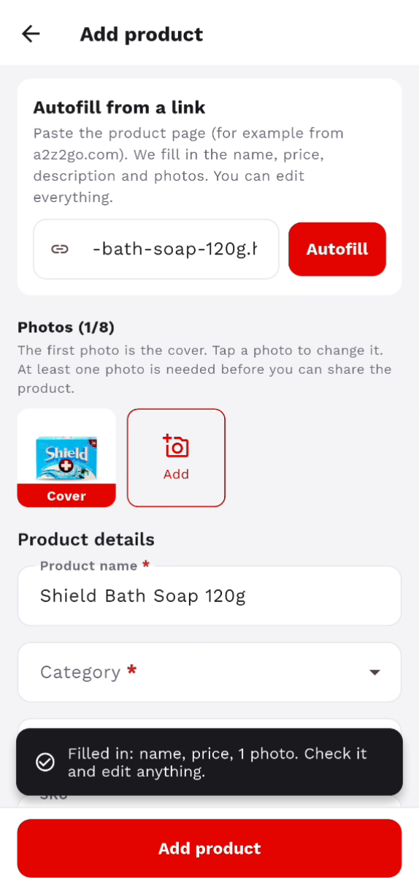
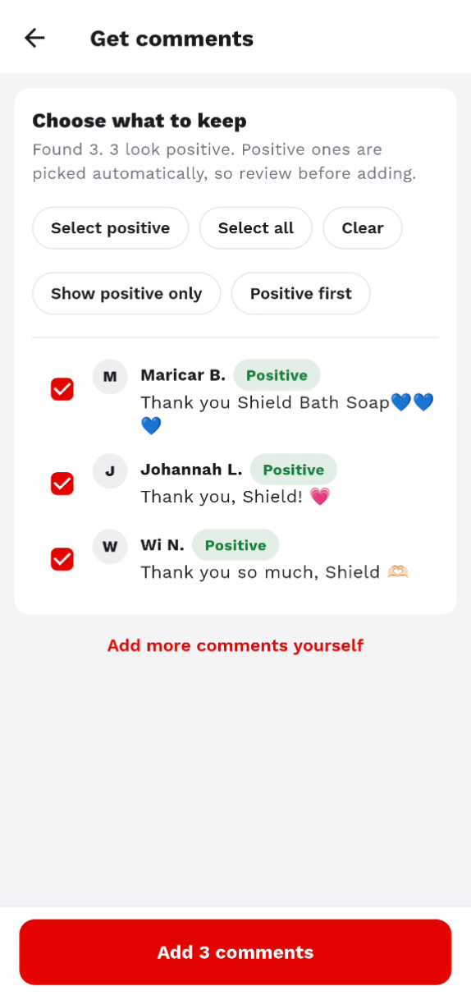
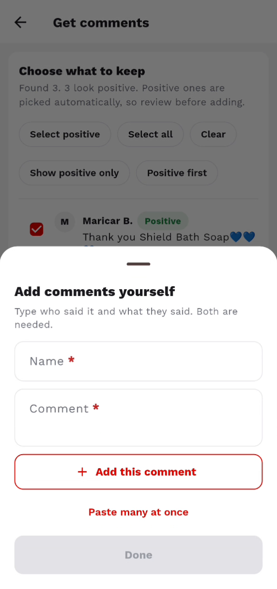
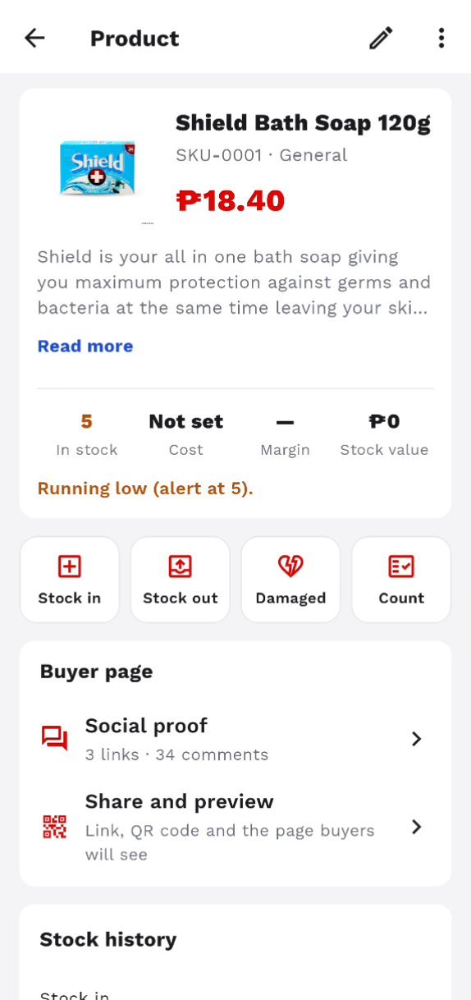
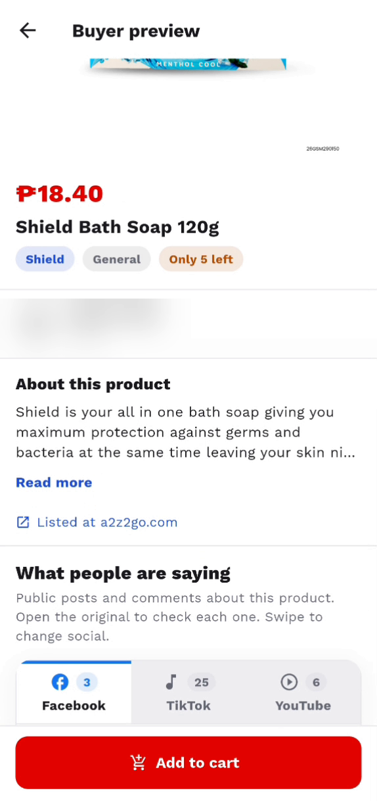
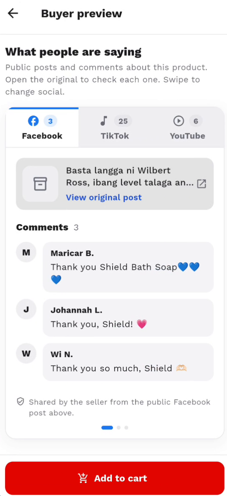

# A2Z2GO Seller App: social proof on the product page

A PDF copy of this page is in [`docs/A2Z2GO-Seller-App-Showcase.pdf`](docs/A2Z2GO-Seller-App-Showcase.pdf).

## The task

Show comments that already exist on social media (Facebook, TikTok, YouTube) on each product page, as proof that
people talk about the product. Every comment links back to the original post, so anyone can check it.

## What was built

- The seller pastes a link to a post. The app reads the comments **by itself**. No copy and paste.
- The seller chooses which comments to keep. The positive ones are ticked for them.
- Buyers see the comments on the product page, with **one tab for each site** and a link to the original post.

## Example product

**Shield Bath Soap 120g**, from the A2Z2GO website:
<https://a2z2go.com/shield-bath-soap-120g.html>

---

## How the seller adds it

<table>
<tr>
<td width="33%" valign="top">
 
<b>1. Add the product.</b> 
The seller pastes the product link from the A2Z2GO website. The app fills in the name, price and photo.
</td>
<td width="33%" valign="top">
 
<b>2. The app reads the comments.</b> 
The seller adds a Facebook post link. The app found 3 comments by itself. The happy ones are ticked.
</td>
<td width="33%" valign="top">
 
<b>3. Or type one in.</b> 
For sites the app cannot read, the seller types a name and a comment. Both are needed.
</td>
</tr>
</table>

## What the buyer sees

<table>
<tr>
<td width="33%" valign="top">
 
<b>4. The product page.</b> 
Price, stock and buttons. "Social proof" shows 3 posts and 34 comments.
</td>
<td width="33%" valign="top">
 
<b>5. What the buyer sees.</b> 
The product page with one tab for each site: Facebook, TikTok and YouTube.
</td>
<td width="33%" valign="top">
 
<b>6. The comments.</b> 
Each tab shows the comments and a link to the original post, so anyone can check.
</td>
</tr>
</table>

---

## Result: checked against the real posts

| Site | Comments in the app | Same as the real post? | Original post |
|---|---|---|---|
| Facebook | 3 | Yes | <https://www.facebook.com/share/p/1Gg1sGx2Yd/> |
| TikTok | 25 | Yes | <https://www.tiktok.com/@makinoaisya/video/7555122895148584199> |
| YouTube | 6 | Yes | <https://www.youtube.com/watch?v=ZdBI-cMabKs> |

## Limits

- **Instagram** shows only its newest comments to people who are not logged in, and they change every few seconds.
- **Shopee, Lazada and other sites** cannot be read yet. The seller types those comments in.
- Everything is saved on the seller's phone for now. There is no server yet.

---

The full step-by-step guide to the whole app is in [`APP_WALKTHROUGH.md`](APP_WALKTHROUGH.md).
